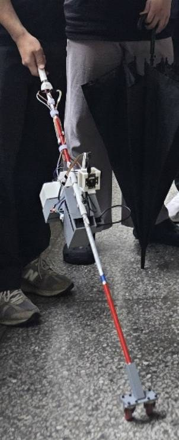
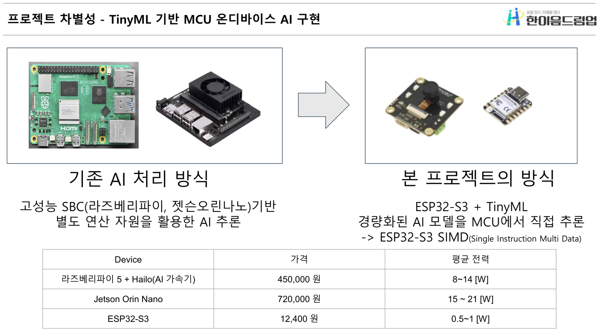
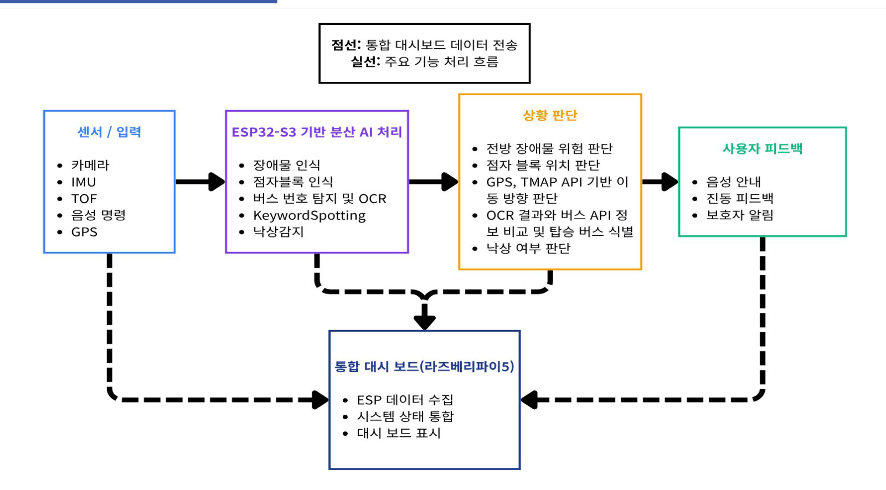
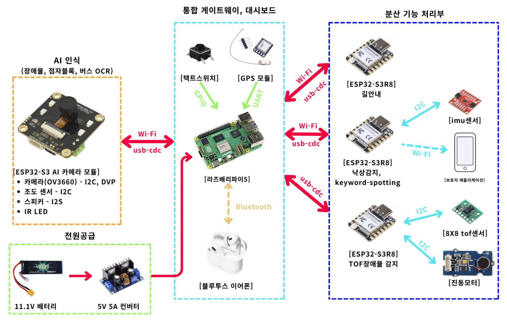
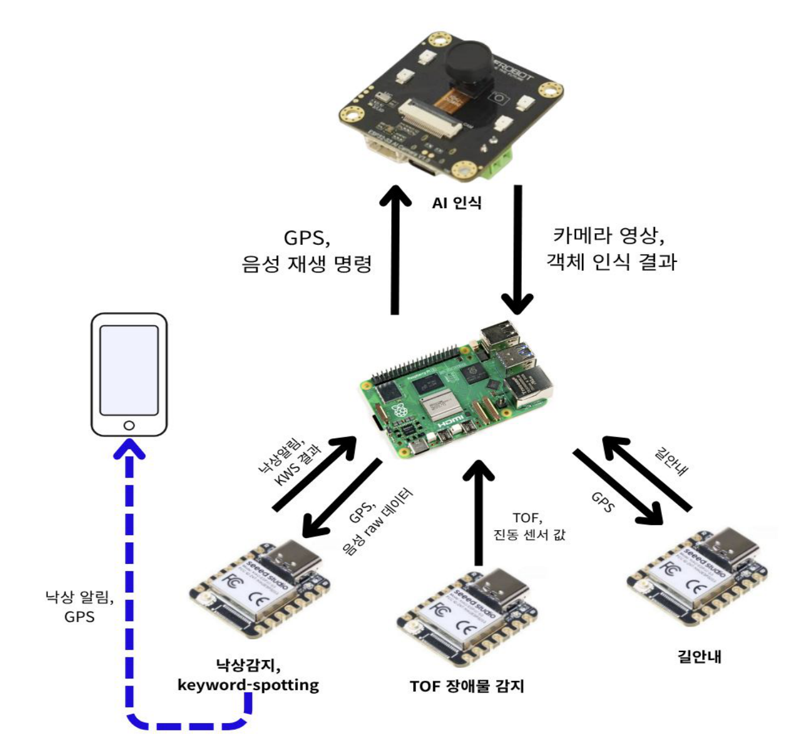
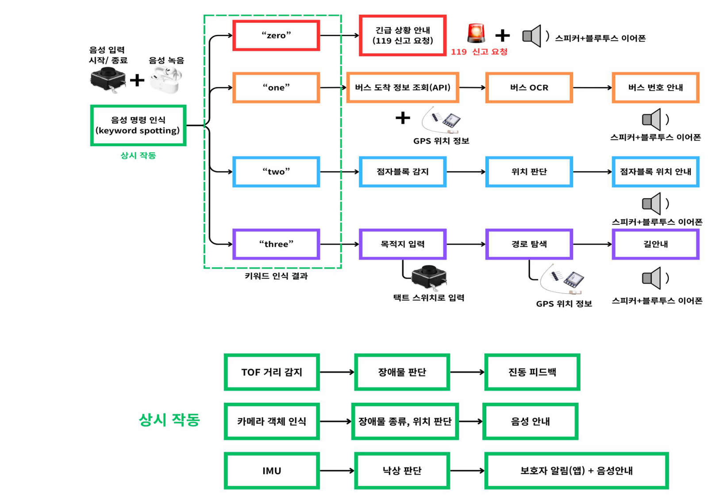
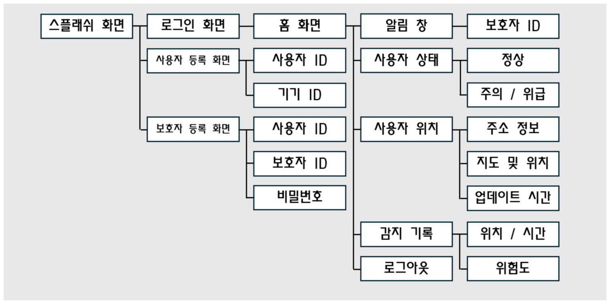

# 🦯 TinyVision Cane (Visionary-T)
**OnDevice AI 기반 시각장애인용 스마트 지팡이** · 2026 한이음 드림업 공모전 `26_HA010` · 팀명 **Tinycane**

---

## **💡1. 프로젝트 개요**

**1-1. 프로젝트 소개**
- 프로젝트 명 : TinyVision Cane(Visionary-T) — OnDevice AI 기반 시각장애인용 스마트 지팡이
- 프로젝트 정의 : 장애물·점자블록·버스 번호 인식, 낙상 감지, 길안내, 음성 명령 기능을 하나의 스마트 지팡이에 통합하고, 모든 AI 추론을 ESP32-S3(MCU)에서 직접 수행하는 온디바이스 AI 보행 보조 플랫폼

  </br>

**1-2. 개발 배경 및 필요성**
- **보행 인프라의 한계** : 전국 점자블록의 바른 설치율은 4%에 불과하고, 점자블록 위에 방치된 자전거·전동킥보드 때문에 충돌과 낙상 위험이 상존합니다.
- **대중교통 이용의 장벽** : 시각장애인의 절반 이상(52.8%)이 버스를 가장 불편한 대중교통으로 꼽습니다. 정차 위치와 버스 번호를 스스로 확인할 수 없어 타인에게 의존하거나 버스를 놓치는 일이 잦습니다.
- **클라우드 의존형 보조기기의 한계** : 기존 스마트 지팡이는 스마트폰·클라우드와 연동해 AI를 처리하므로 네트워크 상태에 따라 지연이 생기고 전력 소모가 큽니다. 보행 보조에서 응답 지연은 곧 안전 문제입니다.
- 따라서 네트워크와 무관하게 기기 안에서 실시간으로 판단하고, 음성·진동으로 직관적으로 알려주는 저전력 온디바이스 AI 지팡이가 필요합니다.

**1-3. 프로젝트 특장점**
- **MCU 기반 TinyML 온디바이스 AI** : 장애물·점자블록·버스 OCR·낙상 감지·Keyword Spotting을 고성능 SBC 없이 ESP32-S3에서 직접 추론합니다. NPU 대신 ESP32-S3의 SIMD 명령어와 ESP-NN 가속 커널, INT8 양자화로 경량 모델을 구동합니다.
- **AI 비전 + ToF 센서 융합** : 카메라로 장애물의 종류를, 8×8 ToF 센서로 거리와 방향을 판단해 두 결과가 일치할 때만 안내하므로 오탐이 적습니다.
- **OCR·GPS·공공 API 이중 검증** : GPS로 근처 정류장을 찾고 버스 도착 API로 후보를 만든 뒤, 카메라 OCR 결과와 대조해 동시에 진입하는 여러 대의 버스도 구분합니다.
- **TinyML 낙상 감지 + 보호자 알림** : IMU 6축 데이터를 1D-CNN으로 분류하고, 10초 동안 지팡이를 다시 드는지 확인해 단순 낙하와 실제 위급 상황을 구분합니다.
- **블루투스 이어폰 음성 인터페이스** : 화면 없이 음성 명령으로 기능을 실행하고, 이어폰으로 안내를 들어 주변 소음과 개인정보 노출을 줄였습니다.

  

**1-4. 주요 기능**
- **장애물 감지(상시)** : ToF 센서 2개(상단 4×4, 중·하단 8×8)로 거리를 측정하고, 위험 구역의 위치(좌/정면/우)와 높이(머리/몸통/발)를 진동 위치와 횟수로 알립니다.
- **장애물 인식(상시)** : SSDLite-MobileNetV2로 사람·자전거·킥보드·볼라드를 인식하고, ToF 방향과 일치하면 종류를 음성으로 안내합니다.
- **음성 명령(Keyword Spotting)** : 지팡이 스위치를 누르고 말하면 `zero`(긴급 119 요청), `one`(버스 안내), `two`(점자블록 안내), `three`(길안내)를 인식해 해당 기능을 실행합니다.
- **버스 번호 인식** : 1분 이내 도착 예정 버스를 API로 조회하고, 카메라로 번호판을 검출·OCR해 탑승할 버스 번호를 안내합니다.
- **점자블록 안내** : 점자블록을 검출해 좌측·정면·우측 중 어느 방향에 있는지 음성으로 안내합니다.
- **길안내** : TMAP 보행자 경로 API로 목적지까지 분기점마다 방향을 안내하고, 경로를 벗어나면 자동으로 재탐색합니다.
- **낙상 감지 및 보호자 알림** : 낙상 시 스피커로 알리고, 일어나지 못하면 보호자 앱에 위치와 함께 긴급 푸시 알림을 보냅니다.

**1-5. 기대 효과 및 활용 분야**
- 기대 효과 : 스마트폰이나 외부 서버 없이 지팡이 하나로 보행·대중교통·안전 기능을 제공해 시각장애인의 독립적인 이동을 돕습니다. 영상·음성 데이터를 외부로 보내지 않아 개인정보 보호에 유리하고, MCU 중심 구조로 제작 비용과 전력을 줄였습니다.
- 활용 분야 : 시각장애인 보행 보조, 대중교통 접근성 지원, 고령자 낙상 모니터링, 저전력 엣지 AI 웨어러블 기기

**1-6. 기술 스택**
- MCU / 펌웨어 : ESP32-S3(XIAO ESP32-S3 ×3, ESP32-S3 AI 카메라 모듈 DFR1154), ESP-IDF, FreeRTOS, C / C++
- AI / ML : TensorFlow Lite Micro, ESP-NN, TensorFlow·Keras, PyTorch, Edge Impulse, Google Colab
- AI 모델 : SSDLite-MobileNetV2(장애물), MobileNetV2 기반 검출기(점자블록·버스 번호판), CNN+CTC(버스 번호 OCR), 1D-CNN(낙상), 2D-CNN+MFCC(KWS)
- 게이트웨이 : Raspberry Pi 5, Python, PySide6(통합 대시보드), pyserial, PipeWire(블루투스 HFP 오디오)
- 센서 / 구동 : VL53L5CX 8×8 ToF ×2, DRV2605 햅틱 드라이버 + LRA 진동모터 ×2, LSM9DS1 IMU, GPS 모듈, OV3660 카메라 + IR LED, 조도 센서
- 외부 API / 클라우드 : TMAP 보행자 경로 API, 공공데이터포털 버스 도착 정보 API, Firebase(Authentication, Firestore, Cloud Functions, Cloud Messaging)
- 모바일 앱 : Flutter / Dart, Flutter Map(OpenStreetMap)
- 통신 : USB CDC(ESP32-S3 ↔ Raspberry Pi 5), I2C, Wi-Fi, Bluetooth
- 협업 : Git / GitHub, Notion, Tailscale

---

## **💡2. 팀원 소개**

| **멘티1 (팀장)** | **멘티2** | **멘티3** | **멘티4** | **멘티5** | **멘토** |
|:---:|:---:|:---:|:---:|:---:|:---:|
| • TinyML 장애물 인식 <br> • ToF·DRV 제어 및 장애물 감지 | • 라즈베리파이 통합 <br> • TinyML 점자블록 인식 <br> • 버스 OCR 알고리즘 | • TinyML 낙상 감지 <br> • 보호자 알림 APP | • TinyML Keyword Spotting | • 라즈베리파이 통합 <br> • 길안내(TMAP·GPS) | • 프로젝트 멘토 <br> • 기술 자문 |

---

## **💡3. 시스템 구성도**

- **서비스 구성도** : 센서·음성 입력을 ESP32-S3가 분산 처리하고, 판단 결과를 음성·진동·보호자 알림으로 전달하며, 라즈베리파이 5가 시스템 데이터를 통합합니다.

  

- **하드웨어 / 센서 구성도** : AI 객체인식부(ESP32-S3 AI 카메라), 통합 게이트웨이(라즈베리파이 5), 분산 기능 처리부(XIAO ESP32-S3 3대 — 길안내 / 낙상감지·KWS / ToF 장애물 감지)로 구성됩니다. 각 ESP32-S3는 USB CDC로 라즈베리파이 5와 통신하면서 전원도 함께 공급받습니다.

  

- **서비스 흐름도** : 라즈베리파이 5를 중심으로 각 보드가 주고받는 데이터

  

- **기능 처리도** : 음성 명령으로 선택 실행되는 기능(긴급 신고·버스·점자블록·길안내)과 상시 동작하는 기능(ToF·카메라·IMU)

  

- **보호자 애플리케이션 메뉴 구성도**

  

- **보드 간 주요 통신 프로토콜(USB CDC)**

| 방향 | 코드 | 내용 |
|---|---|---|
| ToF 보드 → RPi | `0xB2` / `0xB4` | 중·하단 8×8, 상단 4×4 거리 그리드 |
| ToF 보드 → RPi | `0xB3` | 진동 발화 이벤트(높이, 방향, 거리) |
| AI 카메라 → RPi | `0xB0` / `0xB1` / `0xB2` | 장애물(종류·방향·신뢰도) / 버스 OCR / 점자블록 결과 |
| RPi → AI 카메라 | `0x01` / `0x02` / `0x10` | 버스 모드, 점자블록 모드, ToF·AI 방향 일치 시 장애물 음성 안내 |
| 낙상 보드 → RPi | `0xFF` / `0xFE` / `0xFD` | 낙상 감지 / 알림 해제 / 위급 |
| RPi ↔ KWS 보드 | PCM 32,000 B → `RESULT:<label>` | 16 kHz 1초 음성 전송, 인식 결과 수신 |

---

## **💡4. 작품 소개영상**

[](https://youtu.be/wz2xhbisxDc?si=NYlmpoqtdSdYaY8D)

---

## **💡5. 핵심 소스코드**

### 5-1. TinyML 장애물 인식 · ToF 장애물 감지 (멘티1)

**① SSDLite-MobileNetV2 출력 디코딩과 NMS** — `ESP32(객체인식)/main/main.cpp`
- 앵커 1,602개마다 softmax로 클래스 점수를 구하고, BoxCoder(10,10,5,5)와 같은 방식으로 박스를 복원한 뒤 NMS로 겹친 박스를 정리합니다. 가장 확실한 장애물의 중심 x좌표로 좌/중앙/우 방향을 판단합니다.

```cpp
for (int a = 0; a < SSD_ANCHOR_COUNT; a++) {
    // 배경 대비 전경 로짓 차이가 작으면 softmax 계산 전에 바로 건너뜀
    if ((max_fg - logit_bg) < kLogitMargin) continue;
    /* ... softmax로 클래스별 확률 계산 ... */
    for (int c = 1; c < OBS_NUM_CLASSES; c++) {
        float score = probs[c] / sum_exp;
        if (score < kObsConfThres || cand_count >= kObsMaxCandidates) continue;

        // 앵커 + 회귀값으로 박스 복원 (torchvision BoxCoder와 동일)
        float ax = ssd_anchors[a][0], ay = ssd_anchors[a][1];
        float aw = ssd_anchors[a][2], ah = ssd_anchors[a][3];
        float dx = obs_read_bbox(a, 0) / kObsBoxWeightXY;
        float dy = obs_read_bbox(a, 1) / kObsBoxWeightXY;
        float dw = obs_read_bbox(a, 2) / kObsBoxWeightWH;
        float dh = obs_read_bbox(a, 3) / kObsBoxWeightWH;
        float pcx = ax + dx * aw, pcy = ay + dy * ah;
        float pw = aw * expf(dw), ph = ah * expf(dh);

        ObsCandidate &cd = s_obs_candidates[cand_count++];
        cd.class_id = c - 1;
        cd.score = score;
        cd.cx = std::max(0.0f, std::min(1.0f, pcx));
        /* ... x1, y1, x2, y2 클리핑 ... */
    }
}
// 점수 내림차순 정렬 후 같은 클래스끼리 IoU > 임계값이면 억제(NMS)
for (int i = 0; i < cand_count; i++) {
    if (suppressed[i]) continue;
    for (int j = i + 1; j < cand_count; j++)
        if (s_obs_candidates[j].class_id == s_obs_candidates[i].class_id &&
            obs_iou(s_obs_candidates[i], s_obs_candidates[j]) > kObsNmsIou) suppressed[j] = true;
}
r.direction = obs_direction(best.cx);   // cx < 0.33 왼쪽, < 0.66 중앙, 그 외 오른쪽
```

**② ToF 3×3 구역 위험도 판정과 정면 우선 선택** — `ESP32(TOF,DRV)/main/TOF_task.cc`
- 상단 4×4와 중·하단 8×8 거리값을 높이 3구역 × 방향 3구역으로 나누고, 위험 거리 안에 들어온 구역마다 위험도 점수를 매깁니다. 정면 구역을 먼저 고르고 정면이 비어 있을 때만 좌우를 보며, 같은 구역이 연속으로 확인되면 진동을 울립니다. 접근 속도가 빠를수록 임계값을 늘리고, 히스테리시스로 경계값 근처의 깜빡임을 막습니다.

```cpp
// 위험도 점수 = 거리점수(0~50, 가까울수록↑) + 높이 가중치 + 방향 가중치
static int compute_zone_score(int h, int dir, int16_t distance_mm)
{
    const int16_t threshold = kHeightDangerThresholdMm[h];   // TOP 1300 / MID 1800 / BOTTOM 1500 mm
    if (distance_mm < 0) return -1;
    float ratio = 1.0f - ((float)distance_mm / (float)threshold);
    if (ratio < 0.0f) ratio = 0.0f;
    return (int)(ratio * 50.0f) + kHeightWeight[h] + kDirWeight[dir];   // {30,20,10} / {10,20,10}
}

// 정면(CENTER) 우선: 정면에 켜진 구역이 있으면 그중에서만, 없을 때만 좌/우에서 1등 선정
for (int pass = 0; pass < 2 && best_score < 0; ++pass) {
    for (int h = 0; h < 3; ++h) {
        for (int dir = 0; dir < 3; ++dir) {
            if ((pass == 0) != (dir == ZONE_DIR_CENTER)) continue;
            const zone_cell_t &zc = g_zone_grid[h][dir];
            if (!zc.active) continue;
            const int score = compute_zone_score(h, dir, zc.min_distance_mm);
            if (score > best_score) { best_score = score; best_h = h; best_dir = dir; }
        }
    }
}

// 구역 활성 판정: 기본 임계값 + 접근 속도 확장 + 히스테리시스
int thr = kHeightDangerThresholdMm[h] + s_zone_extra_mm[h][dir];   // 다가오는 속도 x 0.6s (최대 +600mm)
if (zc.active) thr += ZONE_HYSTERESIS_MM;                            // 켜진 구역은 150mm 더 멀어질 때까지 유지
zc.active = (min_all[h][dir] >= 0 && min_all[h][dir] <= thr);
```

진동은 방향에 따라 왼쪽·오른쪽·양쪽 모터를, 높이에 따라 3번(머리)·2번(몸통)·길게 1번(발)으로 울립니다.

### 5-2. 점자블록 인식 · 버스 번호 OCR (멘티2)

**① 점자블록 검출과 방향 판단** — `ESP32(객체인식)/main/main.cpp`
- 카메라 영상을 224×224 흑백으로 줄이면서 바로 INT8로 양자화합니다(중간 float 버퍼를 없애 내부 RAM 부족 문제 해결). 14×14 그리드 출력에서 신뢰도가 가장 높은 셀의 중심 좌표로 점자블록이 왼쪽·정면·오른쪽 중 어디 있는지 판단합니다.

```cpp
// 리사이즈 + 정규화 + int8 양자화를 한 루프에서 처리 (196KB float 버퍼 제거)
for (int oy = 0; oy < BB_INPUT_SIZE; oy++) {
    for (int ox = 0; ox < BB_INPUT_SIZE; ox++) {
        /* ... 쌍선형 보간으로 val(0~1) 계산 ... */
        int32_t q = (int32_t)lroundf(val / in_scale) + in_zp;
        in8[oy * BB_INPUT_SIZE + ox] = (int8_t)std::max<int32_t>(-128, std::min<int32_t>(127, q));
    }
}
s_bb_interp->Invoke();

// 출력 (1,14,14,5) = [dx, dy, w, h, conf] — 신뢰도 최댓값 셀 선택
for (int gy = 0; gy < BB_GRID_SIZE; gy++)
    for (int gx = 0; gx < BB_GRID_SIZE; gx++) {
        int base = (gy * BB_GRID_SIZE + gx) * 5;
        float conf = (raw_out[base + 4] - out_zp) * out_scale;
        if (conf > best_conf) { best_conf = conf; best_gx = gx; best_gy = gy;
                                best_dx = (raw_out[base + 0] - out_zp) * out_scale; /* ... */ }
    }
r.cx = (best_gx + best_dx) / (float)BB_GRID_SIZE;
if (best_conf >= BB_CONF_THRESH)
    r.dir = (r.cx < 0.35f) ? "left" : (r.cx > 0.65f) ? "right" : "center";
```

**② 버스 번호 OCR(CTC 디코딩)과 도착 API 후보 매칭** — `ESP32(객체인식)/main/main.cpp`
- 번호판 검출 모델로 찾은 영역을 32×160으로 잘라 CNN+CTC 인식 모델에 넣고, 그리디 CTC 디코딩으로 문자열을 얻습니다. OCR이 일부 글자를 틀려도 버스 도착 API가 준 후보와 최장 공통부분수열(LCS)이 과반이면 매칭으로 인정합니다.

```cpp
// CTC greedy decode: 프레임별 최댓값 클래스에서 blank(0)와 연속 중복 제거
static void bus_ctc_greedy_decode(const float *logits, int T, int C, char *out_str, size_t out_cap) {
    int prev = -1; size_t pos = 0; out_str[0] = '\0';
    for (int t = 0; t < T; t++) {
        const float *row = logits + t * C;
        int best = 0; float best_v = row[0];
        for (int c = 1; c < C; c++) if (row[c] > best_v) { best_v = row[c]; best = c; }
        if (best != prev && best != 0) {
            const char *ch = idx2char(best);
            /* ... out_str에 문자 추가 ... */
        }
        prev = best;
    }
}

// OCR 원문과 API 후보를 LCS로 비교 — 후보 길이의 과반 이상 일치하면 매칭 (예: 837 → 937)
static const char *bus_match_candidate(const char *rec_text) {
    const char *best = nullptr; int best_lcs = 0;
    for (int i = 0; i < s_bus_api_candidate_count; i++) {
        if (s_bus_api_candidates[i].consumed) continue;      // 이미 안내한 버스는 제외
        const char *cand = s_bus_api_candidates[i].route_no;
        int len = (int)strlen(cand);
        int lcs = lcs_length(rec_text, cand);
        if (lcs * 2 > len && lcs > best_lcs) { best_lcs = lcs; best = cand; }
    }
    return best;   // 음성은 OCR 원문이 아니라 후보의 정식 번호로 안내
}
```

### 5-3. 낙상 감지 · 보호자 알림 APP (멘티3)

**① 낙상 후 10초 사용자 반응 감시** — `ESP32(낙상감지&KWS)/main/Fall_detection.cc`
- 1D-CNN이 `event`(확률 0.50 이상)로 판단하면 바로 위급으로 보지 않고, 충격 직후 1.5초를 무시한 뒤 지팡이를 다시 드는 움직임(Δg ≥ 0.30g 또는 |a| ≥ 1.35g)을 10초간 확인합니다. 다시 들면 `safe_fall`, 들지 못하면 `danger_fall`로 판단해 라즈베리파이와 Firebase에 알립니다.

```cpp
bool DetectPickupMotion(uint32_t now_ms) {
  const AccelSample current = CurrentAccelSample();
  /* ... 첫 샘플이면 기준값만 저장 ... */
  const float delta_g = AccelDistanceG(current, previous_accel);
  previous_accel = current;
  if (ElapsedMs(event_started_at_ms, now_ms) < kPickupIgnoreMs) return false;   // 1.5초 충격 보호 구간
  return delta_g >= kPickupDeltaGThreshold ||                                    // 0.30 g
         current.magnitude >= kPickupMagnitudeGThreshold;                        // 1.35 g
}

void UpdatePostEventMonitor(uint32_t now_ms) {
  if (event_monitor_state == EventMonitorState::kWaitingForPickup) {
    if (DetectPickupMotion(now_ms)) {
      ResolveEventAsSafe("cane_picked_up_after_event");      // RPi 0xFE + safe_fall 기록
      return;
    }
    if (ElapsedMs(event_started_at_ms, now_ms) >= kEmergencyAlertDelayMs)   // 10초
      SendEmergencyAlert(now_ms, "no_cane_pickup_after_event");            // RPi 0xFD + danger_fall 전송
    return;
  }
  if (event_monitor_state == EventMonitorState::kAlertSent &&
      ElapsedMs(alert_sent_at_ms, now_ms) >= kAlertCooldownMs) {
    ResetPostEventMonitor();                                  // 10초 쿨다운 후 재감지 대기
  }
}
```

**② 위급 낙상 FCM 푸시 알림(재시도 포함)** — `APP(보호자용)/functions/index.js`
- ESP32가 보낸 상태를 Cloud Function이 검증해 Firestore에 기록하고, `danger_fall`이면 연결된 보호자들의 FCM 토큰으로 고우선순위 알림을 보냅니다. 일시적 오류는 지수 백오프로 최대 3회 재시도합니다.

```js
if (state === "danger_fall") {
  const tokens = await loadFcmTokens(db, guardianUids);
  if (tokens.length) {
    const result = await sendDangerNotificationWithRetry({
      notification: {title: info.title, body: `${patientId}: ${info.body}`},   // "위험 낙상 감지"
      data: {eventId: eventRef.id, deviceId, patientId, state},
      android: {priority: "high", notification: {
        channelId: "fall_alerts", priority: "max", sound: "default"}},
    }, tokens);
    notificationStatus = result.failedCount === 0 ? "sent" :
      result.sentCount > 0 ? "partially_failed" : "failed";
  }
}

async function sendDangerNotificationWithRetry(message, tokens) {
  let pendingTokens = [...tokens], attempts = 0;
  while (pendingTokens.length > 0 && attempts < maxFcmAttempts) {
    attempts++;
    const retryTokens = [];
    for (const tokenChunk of chunks(pendingTokens, maxMulticastTokens)) {
      const result = await getMessaging().sendEachForMulticast({...message, tokens: tokenChunk});
      result.responses.forEach((r, i) => {
        if (!r.success && isRetryableMessagingError(r.error)) retryTokens.push(tokenChunk[i]);
      });
    }
    pendingTokens = retryTokens;
    if (pendingTokens.length > 0) await wait(500 * (2 ** (attempts - 1)));   // 0.5s → 1s → 2s
  }
  /* ... sentCount / failedCount / attempts 반환 ... */
}
```

### 5-4. Keyword Spotting (멘티4)

**① ESP32-S3 온디바이스 키워드 추론** — `ESP32(낙상감지&KWS)/main/keyword_spotting.cc`
- 라즈베리파이에서 받은 16 kHz·1초 PCM(32,000 B)을 float로 바꿔 Edge Impulse 모델(MFCC + 2D-CNN)에 넣습니다. 같은 보드의 낙상 모델과 동시에 추론하지 않도록 공용 Mutex로 Invoke 구간을 직렬화하고, 결과를 문자열로 돌려보냅니다.

```cpp
void RunKeywordInference() {
  auto* pcm_audio = reinterpret_cast<int16_t*>(inference_audio);
  for (size_t i = kSampleCount; i-- > 0;)                 // 같은 버퍼에서 int16 → float 변환
    inference_audio[i] = static_cast<float>(pcm_audio[i]);

  signal_t signal = {};
  signal.total_length = kSampleCount;
  signal.get_data = &GetSignalData;
  ei_impulse_result_t result = {};

  // 낙상 모델과 추론 충돌 방지. RPi 응답 타임아웃(10s)보다 짧은 8s로 대기
  if (!LockAiInference(pdMS_TO_TICKS(8000))) { WriteUsb("KWS_BUSY\n"); return; }
  const EI_IMPULSE_ERROR error = run_classifier(&signal, &result, false);
  UnlockAiInference();
  if (error != EI_IMPULSE_OK) { WriteUsb("KWS_ERROR\n"); return; }

  size_t best_index = 0;
  float best_score = result.classification[0].value;
  for (size_t i = 1; i < EI_CLASSIFIER_LABEL_COUNT; ++i)
    if (result.classification[i].value > best_score) { best_score = result.classification[i].value; best_index = i; }

  char response[128];
  std::snprintf(response, sizeof(response), "RESULT:%s (%.2f) %s\n",
                result.classification[best_index].label, best_score,
                best_score >= kResultThreshold ? "ACCEPTED" : "REJECTED");
  WriteUsb(response);
}
```

**② 블루투스 마이크 음성 다운샘플링·전송과 기능 매핑** — `라즈베리파이(대시보드)/keyword_spotting_link.py`
- 블루투스 이어폰(HFP)으로 48 kHz 녹음한 음성을 16 kHz로 다운샘플링해 512 B씩 ESP32-S3로 보내고, 인식된 키워드를 기능 모드로 바꿉니다.

```python
def _send_and_get_result(self):
    with wave.open(TEMP_WAV, "rb") as wf:
        raw_rate = wf.getframerate()
        raw = np.frombuffer(wf.readframes(wf.getnframes()), dtype=np.int16).astype(np.float32)

    if raw_rate == 48000:
        resampled = resample_poly(raw, 1, 3)          # 48 kHz → 16 kHz
    elif raw_rate == 32000:
        resampled = resample_poly(raw, 1, 2)
    else:
        resampled = raw
    audio_data = np.clip(resampled, -32768, 32767).astype(np.int16).tobytes()

    with self._write_lock:                            # 1초 분량(32,000 B)을 512 B씩 USB CDC로 전송
        for i in range(0, ESP_SAMPLE_COUNT, CHUNK_SIZE):
            self._ser.write(audio_data[i:i + CHUNK_SIZE])
            time.sleep(0.002)

    result_line = ...                                 # "RESULT:<label> (score) ACCEPTED" 수신 대기
    if not result_line or "REJECTED" in result_line:
        return None
    label = result_line.replace("RESULT:", "").split("(")[0].strip().lower()
    if "one" in label:   return "bus_ocr"             # 버스 OCR + 도착 API
    if "two" in label:   return "braille"             # 점자블록 안내
    if "three" in label: return "guide"               # TMAP 길안내
    if "zero" in label:  return "emergency"           # 119 긴급 요청
    return None
```

### 5-5. 라즈베리파이 통합 · 길안내 (멘티5, 멘티2)

**① GPS 위치 보정(정지 중 평균 고정, 튄 좌표 제거)** — `ESP32(길안내)/main/main.c`
- 지팡이 IMU의 정지·이동 정보와 지자기 방위를 이용해 GPS 오차를 줄입니다. 멈춰 있을 때는 좌표를 평균해 고정하고, 걷는 중에는 진행 방향과 100° 넘게 다른 쪽으로 4 m 넘게 튄 좌표를 버립니다.

```c
static GpsAccept_t gps_accept(double lat, double lon) {
    /* ... 직전 좌표와 비교해 GPS 속도 v 계산, 빠르면 fast_cnt 증가 ... */
    float hdg = 0.0f; bool ok = false, moving = false;
    if (!USE_HEADING_ASSIST || !heading_snapshot(&hdg, &ok, &moving)) {
        gps_update(lat, lon);                              // 지자기 정보가 없으면 GPS만 사용
        return GPS_TAKEN;
    }

    /* A. 정지 중 고정 — 신호 대기 중 GPS 흔들림으로 경로 이탈 오판 방지 */
    bool gps_says_moving = fast_cnt >= MOTION_OVERRIDE_CONFIRM;
    if (!moving && !gps_says_moving) {
        if (hold_n < HOLD_MAX_SAMPLES) hold_n++;           // 최대 30개 평균
        hold_lat += (lat - hold_lat) / hold_n;
        hold_lon += (lon - hold_lon) / hold_n;
        gps_update(hold_lat, hold_lon);
        return GPS_HELD;
    }

    /* B. 튄 좌표 버리기 — 걷는 방향과 크게 다른 쪽으로 튀면 무시 */
    if (ok && moving && have_acc) {
        double d = calculate_distance(acc_lat, acc_lon, lat, lon);
        double diff = fabs(wrap180(bearing_deg(acc_lat, acc_lon, lat, lon) - hdg));
        if (d > JUMP_MIN_M && diff > JUMP_HEADING_DEG && ++reject_cnt < JUMP_MAX_REJECT) {
            gps_update(acc_lat, acc_lon);                  // 위치는 그대로, 수신 시각만 갱신
            return GPS_REJECTED;
        }
    }
    reject_cnt = 0;
    acc_lat = lat; acc_lon = lon; have_acc = true;
    gps_update(lat, lon);
    return GPS_TAKEN;
}
```

**② 경로 이탈 판정(히스테리시스)과 재탐색** — `ESP32(길안내)/main/main.c`
- 매초 현재 위치와 보행 경로선 사이 거리를 계산해 20 m 밖이 4번 연속이면 이탈로 확정하고, 5 m 안으로 돌아오면 해제합니다. 이탈하면 현재 위치에서 TMAP 경로를 다시 요청하며, 실패할수록 재시도 간격을 늘립니다.

```c
double off_dist = fresh ? distance_to_route_meters(my_lat, my_lon, &seg_idx) : -1.0;

/* (A) 이탈 판정: 20m 밖 4번 연속이면 이탈, 5m 안으로 오면 해제 */
if (!off_route) {
    if (off_dist > OFF_ROUTE_DISTANCE_M) {
        if (++off_route_count >= OFF_ROUTE_CONFIRM_CNT) {
            off_route = true;
            usb_send_signal(SIGNAL_OFF_ROUTE);
        }
    } else {
        off_route_count = 0;
    }
} else if (off_dist < ON_ROUTE_DISTANCE_M) {
    off_route = false;
    off_route_count = 0;
    usb_send_signal(SIGNAL_BACK_ON_ROUTE);
}

/* (B) 재탐색: 성공하면 새 경로로, 실패하면 간격을 2배씩(10s → 최대 60s) 늘려 재시도 */
if (off_route && xTaskGetTickCount() >= next_reroute_allowed) {
    if (try_reroute()) {
        off_route = false;
        announced_idx = -1;
        next_reroute_allowed = xTaskGetTickCount() + pdMS_TO_TICKS(REROUTE_COOLDOWN_MS);
        continue;
    }
    next_reroute_allowed = xTaskGetTickCount() + pdMS_TO_TICKS(retry_ms);
    retry_ms = (retry_ms * 2 > REROUTE_RETRY_MAX_MS) ? REROUTE_RETRY_MAX_MS : retry_ms * 2;
}
```

**③ 라즈베리파이 5 통합 게이트웨이 — 음성 명령 분기와 AI·ToF 방향 교차 확인** — `라즈베리파이(대시보드)/dashboard.py`
- 키워드 인식 결과에 따라 각 보드에 모드 전환 명령을 보내고, AI 카메라가 인식한 장애물 방향과 ToF 보드가 진동을 울린 방향이 같을 때만 장애물 종류를 음성으로 안내합니다.

```python
def on_keyword_recognized(mode):
    if mode == MODE_BUS_OCR:
        link.request_bus_mode()        # AI 카메라 → 버스 OCR 모드(0x01)
    elif mode == MODE_BRAILLE:
        link.request_braille_mode()    # AI 카메라 → 점자블록 모드(0x02)
    elif mode == MODE_GUIDE:
        trigger_guide_mode()           # 길안내 모드 진입 음성
    elif mode == MODE_EMERGENCY:
        trigger_emergency_alert()      # "긴급상황발생 119신고요청"
    else:
        link.send_retry_prompt()       # "다시 말씀해주세요"

def on_obstacle_for_confirm(object_name, direction_name, confidence):
    nonlocal _last_confirmed_object
    if object_name == "미상":
        _last_confirmed_object = None
        return
    if not window.tof_direction_active(direction_name):   # ToF 마지막 진동 방향(0xB3)과 일치할 때만
        return
    object_code = OBJECT_CODES.get(object_name)
    if object_code is None or object_code == _last_confirmed_object:
        return
    _last_confirmed_object = object_code
    link.send_obstacle_confirm(object_code)                # 0x10 → "킥보드" 등 음성 안내
```

---

## **📁 저장소 구조**

| 폴더 | 보드 / 역할 |
|---|---|
| `ESP32(객체인식)/` | ESP32-S3 AI 카메라 — 장애물·점자블록·버스 OCR TFLite Micro 추론, 음성 안내 |
| `ESP32(TOF,DRV)/` | XIAO ESP32-S3 — ToF 2개 장애물 감지, DRV2605 진동 제어 |
| `ESP32(낙상감지&KWS)/` | XIAO ESP32-S3 — IMU 낙상 감지, Keyword Spotting, Firebase 알림 |
| `ESP32(길안내)/` | XIAO ESP32-S3 — TMAP 보행자 길안내, GPS 보정, 경로 이탈 재탐색 |
| `라즈베리파이(대시보드)/` | Raspberry Pi 5 — 통합 게이트웨이, PySide6 대시보드, 블루투스 오디오 |
| `APP(보호자용)/` | Flutter 보호자 앱, Firebase Cloud Functions |
| `AI학습/` | 장애물·점자블록·버스 번호 검출·인식 모델 학습 코드 |
